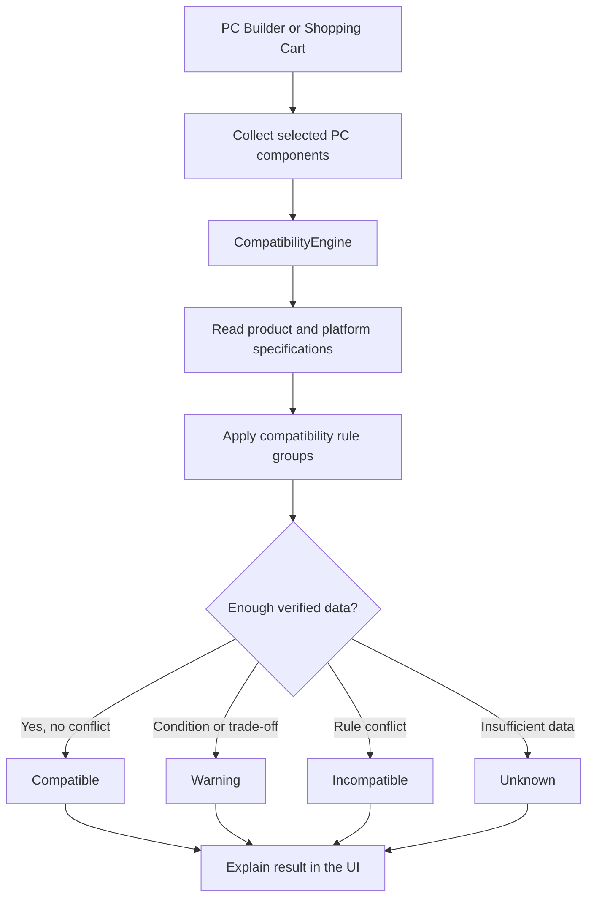
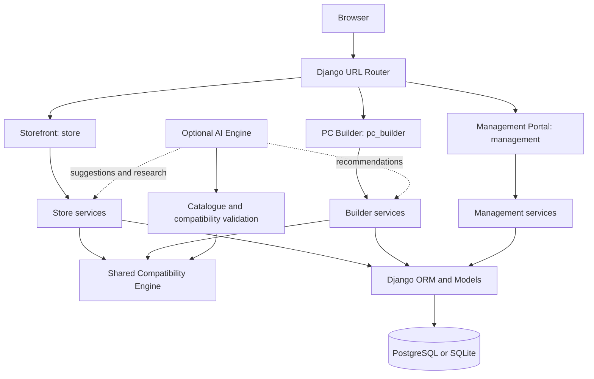

<div align="center">
  
  <h1>CoreCraftr</h1>
  <p><strong>Build Smarter. Build Better.</strong></p>
  <p>A hardware store, an intelligent PC builder, and an inventory workbench — working together in one Django application.</p>
  <p>
    
    
    
    
    
  </p>
  <p>
    <a href="ARCHITECTURE.md">Architecture</a> ·
    <a href="FRONTEND_DESIGN.md">Frontend design system</a> ·
    <a href="https://github.com/rhutik123/CoreCraftr">GitHub repository</a>
  </p>
</div>

---

## ✨ What is CoreCraftr?

**CoreCraftr** is a modular Django application for exploring computer hardware, planning compatible PC builds, and managing the products and stock behind a hardware storefront.

It brings three connected experiences into one place:

- **For shoppers:** discover components, compare specifications, build a PC, check a cart for hardware conflicts, and place demo orders.
- **For PC builders:** get a guided starting point or choose every component manually, with compatibility feedback based on structured hardware data.
- **For store operators:** manage categories, products, specifications, images, inventory, CSV batches, staff access, and audit history from a dedicated portal.

The project is designed around one important principle: **hardware compatibility should be explainable and verifiable.** AI can help with recommendations and research, but it does not decide whether two components physically or electrically fit together. That decision belongs to the deterministic compatibility engine and the data available in the catalogue.

## 🧭 Contents

- [Core ideas](#-core-ideas)
- [Features](#-features)
- [How compatibility works](#-how-compatibility-works)
- [Application architecture](#-application-architecture)
- [Technology stack](#-technology-stack)
- [Getting started](#-getting-started)
- [Configuration](#-configuration)
- [Using the application](#-using-the-application)
- [PC Builder API](#-pc-builder-api)
- [CSV catalogue format](#-csv-catalogue-format)
- [Tests and quality checks](#-tests-and-quality-checks)
- [Security and production notes](#-security-and-production-notes)
- [Current limitations](#-current-limitations)
- [Possible next steps](#-possible-next-steps)

---

## 🧠 Core ideas

### 1. Compatibility is not a chatbot answer

The `CompatibilityEngine` evaluates structured component specifications using explicit rules. It can report a confirmed match, a conflict, a warning, or insufficient information. It does not ask an LLM to invent a compatibility result.

### 2. Missing information stays visible

A product with incomplete specifications should not silently appear compatible. CoreCraftr uses an `unknown` state when the available catalogue data cannot support a reliable conclusion. This makes data quality part of the user experience rather than hiding it.

### 3. Beginner and Expert modes share one build

The guided Beginner experience and the slot-by-slot Expert experience work with the same active `PCBuild`. Switching modes changes the way a shopper works; it does not discard the components already selected.

### 4. AI suggestions are constrained by the catalogue

Optional AI recommendations must resolve to real, active, in-stock products in the correct component category. Proposed builds are checked by the compatibility engine before they are accepted. When AI is unavailable or its response fails validation, deterministic recommendations and manual workflows remain available.

---

## 🚀 Features

### 🛍️ Storefront and product discovery — `store`

- **Structured hardware catalogue:** 13 starter categories covering processors, motherboards, RAM, graphics cards, storage, power supplies, cases, coolers, case fans, monitors, keyboards, mice, and accessories.
- **Product specifications:** structured hardware profiles, additional product specifications, brand/category relationships, product status, and multiple product images.
- **Search and filters:** search the catalogue and narrow results with category, brand, price, stock, socket, memory-generation, and other relevant filters.
- **Product comparison:** compare up to four products from the same category in a side-by-side specification matrix, with differences made easier to spot.
- **Guest and customer carts:** add products without creating an account. A guest cart can be merged into the customer's cart after login.
- **Cart compatibility review:** check internal PC components together, review Beginner- and Expert-oriented explanations, and see catalogue-backed replacement suggestions. Compatibility warnings are informative; they do not automatically block checkout.
- **Checkout and orders:** totals are recalculated on the server, stock is checked again, and inventory deductions happen inside a database transaction. Orders retain product-name and price snapshots.
- **Customer account features:** registration, login/logout, password reset, profile and delivery details, order history, and a persistent wishlist.
- **Indian currency presentation:** prices are formatted in Indian Rupees (INR).

### 🧩 Intelligent PC Builder — `pc_builder`

The PC Builder provides two ways to assemble a system.

| Mode | Designed for | What it does |
| :--- | :--- | :--- |
| **Beginner** | First-time builders or shoppers who want guidance | Starts with budget, workload, priorities, upgrade preferences, preferred brands, and optional peripherals. It explains suggested parts and trade-offs. |
| **Expert** | Users who already know the components they want | Provides a direct component-slot picker, technical filters, a compatible-only option, item status indicators, and smart alternatives. |

Both modes use the same active build. The builder also supports:

- Selecting, replacing, removing, and reviewing components by slot.
- Compatibility summaries and estimated system power requirements.
- Smart alternatives such as cheaper, similar, or higher-tier options where catalogue data supports them.
- Saving build snapshots for authenticated users.
- Loading or deleting saved builds.
- Adding a complete build to the shopping cart in one action.

### 🔬 Deterministic hardware compatibility engine

The compatibility engine is shared by the PC Builder and the storefront cart. It evaluates the component relationships represented in the database and returns one of four states:

| State | Meaning |
| :--- | :--- |
| **Compatible** | The available specifications support the combination. |
| **Warning** | The combination may work, but a condition, limitation, or trade-off needs attention. |
| **Incompatible** | A defined rule identifies a conflict. |
| **Unknown** | The catalogue does not contain enough information to make a reliable determination. |

Checks include:

- **CPU and motherboard:** socket matching, chipset/CPU family support, motherboard CPU support overrides, and BIOS notes.
- **Memory:** DDR generation, DIMM slots, supported capacity, CPU memory support, and JEDEC versus XMP/EXPO speed advisories.
- **Graphics card and case:** graphics card length compared with the case's supported GPU clearance.
- **CPU cooler:** socket support, stock-cooler availability, cooler height, radiator clearance, and thermal capacity information.
- **Motherboard and case:** motherboard form-factor support.
- **Storage:** M.2 NVMe/SATA slots, SATA ports, drive-bay constraints, and slot-sharing notes.
- **Power supply:** estimated system peak power, wattage headroom, PSU size, and required PCIe/12VHPWR power connectors.
- **Build advisories:** missing integrated graphics when no dedicated GPU is selected, and single-channel memory configurations.

The engine does not treat a shared socket as proof of full compatibility. For example, CPU support can depend on chipset and BIOS information as well as socket type.

### 🤖 Optional AI and specification research — `ai_engine`

AI is an enhancement, not a hard dependency.

- **Build recommendations:** optional OpenAI or Gemini-backed recommendations are translated into product selections from the active catalogue and validated before use.
- **Cart conflict advice:** explains detected compatibility issues and can suggest verified replacement pairs.
- **Product specification research:** staff can request research while creating or editing a product. The research workflow can use supported search providers and publicly accessible manufacturer references.
- **Reviewable research drafts:** proposed specification values are constrained to the application's spec schema and carry verification statuses, such as `Sourced`, `Needs verification`, `Conflicting sources`, `Not found`, and `Manually entered`.
- **Manual control:** researched values do not silently overwrite staff-entered data; staff remain responsible for reviewing and accepting changes.
- **Fallback behaviour:** when AI is disabled, credentials are missing, a provider fails, or output does not pass validation, deterministic recommendations and manual entry remain available.

### 🧰 Owner and Inventory Management Portal — `management`

The management portal is a staff workspace separate from the customer storefront.

| Role | Access |
| :--- | :--- |
| **Owner** | Full portal control, staff provisioning and revocation, and read-only audit-log access. Owners are Django superusers. |
| **Inventory Manager** | Product, category, media, specification, inventory, CSV, and reporting workflows. Cannot access owner-only staff administration, audit pages, or Django Admin. |

Portal capabilities include:

- Create, edit, activate, deactivate, and safely remove hardware categories.
- Create and edit products with unique SKUs, brand/category assignments, publication status, image galleries, and category-specific specifications.
- Keep products in `draft`, `published`, or `archived` states without erasing historical order records.
- Validate uploaded JPEG, PNG, and WEBP images using Pillow and an upload-size limit.
- Adjust stock with `add`, `subtract`, and `set` operations, guarded against invalid quantities and stale updates.
- Track stock movements, price changes, and append-only audit events.
- Import catalogues through a preview-and-confirm CSV workflow; export catalogue and supported specification data.
- Review inventory valuation using recorded cost-price information.
- Manage staff access through owner-controlled workflows.

### 🎨 Adaptive interface

- Dark, Light, and System theme options.
- Dark-first visual system with copper-orange and technical-blue accents.
- Tailwind CSS v4 compiled into a local stylesheet.
- Vanilla JavaScript for theme controls, menus, drawers, dialogs, cart updates, and management interactions.
- Lucide icons bundled locally instead of relying on a runtime icon CDN.
- Responsive storefront, builder, and staff portal layouts.

---

## ⚙️ How compatibility works

At a high level, a build or cart is passed to the shared compatibility service. The service reads component categories and their structured specifications, applies explicit hardware rules, and returns a structured result that the relevant interface can explain.



AI may help choose or explain catalogue products, but it does not replace the rule engine. AI-generated product IDs and category assignments are checked against the database, and proposed combinations are passed through deterministic validation.

For a deeper explanation of the data model and rule groups, see [`ARCHITECTURE.md`](ARCHITECTURE.md).

---

## 🏗️ Application architecture

CoreCraftr is a **modular Django monolith**. Its domain apps are separated by responsibility, while sharing one database, authentication system, and deployment unit. Business logic is organized in service modules so HTML views and JSON API endpoints can reuse the same rules.



### Repository layout

```text
CoreCraftr/
├── corecraftr/                   # Django settings, root URLs, WSGI and ASGI
├── store/                        # Catalogue, accounts, cart, checkout, orders, wishlist
│   ├── management/commands/      # Category and hardware catalogue seed commands
│   ├── services/                 # Catalogue, cart, comparison, compatibility bridge, orders
│   ├── templates/store/          # Storefront pages and partials
│   └── models.py                 # Products, specs, inventory, carts and orders
├── pc_builder/                   # Beginner/Expert PC Builder and JSON API
│   ├── services/                 # Compatibility rules, alternatives, build workflows
│   ├── templates/pc_builder/     # Builder workspace, picker and saved builds
│   └── models.py                 # Builds, components and CPU support matrices
├── ai_engine/                    # Optional AI orchestration and spec research
│   └── services/                 # Recommendations, web search, validation and fallback
├── management/                   # Owner and Inventory Manager portal
│   ├── management/commands/      # Demo portal data seeder
│   ├── services/                 # Products, inventory, CSV, images, users, audit
│   └── templates/management/     # Portal dashboard and management screens
├── templates/                    # Shared layouts, components and error pages
├── frontend_src/                 # Tailwind CSS source and design tokens
├── static/                       # Compiled CSS, JavaScript, icons and image assets
├── .env.example                  # Environment variable template
├── ARCHITECTURE.md               # Detailed backend and data architecture
├── FRONTEND_DESIGN.md            # Theme, component and frontend build notes
├── manage.py
├── pytest.ini
└── requirements.txt
```

### Design references

- [`ARCHITECTURE.md`](ARCHITECTURE.md) — domain boundaries, model relationships, compatibility checks, AI validation, and portal access rules.
- [`FRONTEND_DESIGN.md`](FRONTEND_DESIGN.md) — theme tokens, Tailwind build process, JavaScript primitives, and interface structure.

---

## 🧱 Technology stack

| Layer | Technology | Purpose |
| :--- | :--- | :--- |
| Language | Python 3.11+ target | Application logic |
| Web framework | Django 5.2 | Routing, ORM, authentication, forms, templates, admin |
| API | Django REST Framework | Session-authenticated PC Builder JSON endpoints |
| Filtering | django-filter | Catalogue filtering support |
| Database | PostgreSQL / SQLite | Persistent application data |
| Frontend | Django Templates, Tailwind CSS v4 | Server-rendered, responsive interface |
| Browser behaviour | Vanilla JavaScript | Theme, cart, menu, and portal interactions |
| Icons | Lucide (bundled locally) | Interface iconography |
| Image validation | Pillow | Product image validation and processing |
| Static files | WhiteNoise | Static asset serving support |
| Environment | python-dotenv | Local `.env` configuration |
| Testing | pytest, pytest-django | Automated application tests |

Dependencies are listed in [`requirements.txt`](requirements.txt). The repository targets Django `5.2.x` and supports Python `3.11+` as documented by the project.

---

## 💻 Getting started

### Prerequisites

- Python 3.11 or newer.
- Git.
- PostgreSQL for a PostgreSQL-backed setup, or no separate database server for the local SQLite fallback.
- A terminal (PowerShell instructions are shown below; equivalent commands for macOS/Linux follow).

### 1. Get the source code

```bash
git clone https://github.com/rhutik123/CoreCraftr.git
cd CoreCraftr
```

### 2. Create and activate a virtual environment

**Windows PowerShell**

```powershell
python -m venv .venv
.\.venv\Scripts\Activate.ps1
```

**macOS / Linux**

```bash
python3 -m venv .venv
source .venv/bin/activate
```

### 3. Install Python dependencies

```bash
python -m pip install --upgrade pip
pip install -r requirements.txt
```

### 4. Create your local environment file

**Windows PowerShell**

```powershell
Copy-Item .env.example .env
```

**macOS / Linux**

```bash
cp .env.example .env
```

Open `.env` and set the values for your environment. The example file is configured for local development and intentionally contains placeholders, not usable production credentials.

### 5. Choose a database

**Option A — SQLite (quick local setup)**

Set the following in `.env`:

```dotenv
DB_ENGINE=sqlite
```

SQLite is suitable for a quick local start and automated tests. By default, the database file is created as `db.sqlite3` in the project root. You can override its location with `SQLITE_DB_PATH`.

**Option B — PostgreSQL**

Create a PostgreSQL database, then configure `.env`:

```dotenv
DB_ENGINE=postgresql
DB_NAME=corecraftr_db
DB_USER=postgres
DB_PASSWORD=your-real-database-password
DB_HOST=127.0.0.1
DB_PORT=5432
DJANGO_ALLOW_SQLITE_FALLBACK=False
```

The application uses PostgreSQL when a real non-placeholder password is supplied, or when SQLite fallback is explicitly disabled. With the default fallback setting enabled, an empty or placeholder PostgreSQL password causes the app to use SQLite instead. For production, disable fallback so a database configuration mistake does not silently switch database engines.

### 6. Apply migrations

```bash
python manage.py migrate
```

### 7. Initialize the catalogue

Choose the data setup that fits your use case.

**Clean catalogue — categories only**

```bash
python manage.py init_categories
```

Creates any missing starter categories without creating sample products. Existing categories are left untouched, so owner customizations are preserved.

**Demo catalogue — sample hardware and support data**

```bash
python manage.py seed_hardware_catalog
```

Creates the starter catalogue data and CPU/chipset support records used by the builder. This is the easiest way to explore the application with sample hardware.

**Optional — management portal demo data**

```bash
python manage.py seed_portal_demo
```

Adds demo products and management scenarios such as stock movements, price changes, sample order history, and demo user records. Use this command only with a development or disposable database. Review the command output and source before using seeded accounts in any shared environment.

### 8. Build frontend assets and collect static files

```bash
tailwindcss -i frontend_src/tailwind.css -o static/css/app.min.css --minify
python manage.py collectstatic --noinput
```

Rebuild the CSS bundle whenever Tailwind classes or frontend design tokens change. `collectstatic` prepares static assets for deployment; it is also useful when checking the WhiteNoise-ready output locally.

### 9. Create an Owner account

```bash
python manage.py createsuperuser
```

The Owner account can access the management portal and Django Admin. Use a separate non-superuser staff account for Inventory Manager workflows.

### 10. Start the development server

```bash
python manage.py runserver
```

Open the application at:

| Area | Local URL |
| :--- | :--- |
| Storefront | `http://127.0.0.1:8000/` |
| Product catalogue | `http://127.0.0.1:8000/store/` |
| Product comparison | `http://127.0.0.1:8000/compare/` |
| PC Builder | `http://127.0.0.1:8000/builder/` |
| PC Builder API | `http://127.0.0.1:8000/builder/api/build/` |
| Management portal | `http://127.0.0.1:8000/management/` |
| Django Admin | `http://127.0.0.1:8000/admin/` |

---

## 🔧 Configuration

All settings are loaded from environment variables, with `.env` read locally when `python-dotenv` is installed. See [`.env.example`](.env.example) for the complete template.

### Application and database settings

| Variable | Purpose | Local example / default |
| :--- | :--- | :--- |
| `DJANGO_SECRET_KEY` | Django signing key; required when debug is disabled | Set a long, random secret |
| `DJANGO_DEBUG` | Enables development debug mode | `True` in `.env.example` |
| `DJANGO_ALLOWED_HOSTS` | Comma-separated allowed hostnames | `127.0.0.1,localhost` |
| `DJANGO_CSRF_TRUSTED_ORIGINS` | Trusted origins for CSRF checks | Local HTTP origins |
| `DJANGO_TIME_ZONE` | Application timezone | `Asia/Kolkata` |
| `DB_ENGINE` | `postgresql` or `sqlite` | `postgresql` in `.env.example` |
| `DB_NAME` | PostgreSQL database name | `corecraftr_db` |
| `DB_USER` | PostgreSQL user | `postgres` |
| `DB_PASSWORD` | PostgreSQL password | Placeholder in `.env.example` |
| `DB_HOST` | PostgreSQL host | `127.0.0.1` |
| `DB_PORT` | PostgreSQL port | `5432` |
| `DJANGO_ALLOW_SQLITE_FALLBACK` | Allows local SQLite fallback when PostgreSQL credentials are blank or placeholders | `True` |
| `SQLITE_DB_PATH` | Optional SQLite database file path | Project-root `db.sqlite3` |

### Email settings

The default backend writes email output to the terminal, which is useful for local password-reset testing.

| Variable | Purpose |
| :--- | :--- |
| `EMAIL_BACKEND` | Django email backend |
| `EMAIL_HOST` | SMTP server hostname |
| `EMAIL_PORT` | SMTP server port |
| `EMAIL_USE_TLS` | Enable TLS for SMTP |
| `EMAIL_HOST_USER` | SMTP account username |
| `EMAIL_HOST_PASSWORD` | SMTP password or provider app password |
| `DEFAULT_FROM_EMAIL` | Sender address |

### Optional AI and product research settings

| Variable | Purpose | Supported values / default |
| :--- | :--- | :--- |
| `AI_PROVIDER` | Recommendation and AI provider | `none`, `openai`, `gemini` — default `none` |
| `AI_API_KEY` | API key for the selected AI provider | Empty unless configured |
| `AI_MODEL` | Model identifier passed to the provider | `gpt-4o-mini` |
| `AI_TIMEOUT_SECONDS` | Provider request timeout | `15` |
| `AI_SEARCH_PROVIDER` | Search provider for product specification research | `none`, `tavily`, `serper`, `google_cse` |
| `AI_SEARCH_API_KEY` | Search provider API key | Empty unless configured |
| `AI_SEARCH_ENGINE_ID` | Search engine ID for Google Custom Search | Required for `google_cse` |
| `AI_RESEARCH_RATE_LIMIT_PER_HOUR` | Per-user hourly research request limit | `20` |
| `PRODUCT_IMAGE_MAX_BYTES` | Maximum product image size in bytes | `5242880` (5 MB) |

Keep `AI_PROVIDER=none` to use CoreCraftr without external AI calls. The catalogue, compatibility engine, deterministic recommendations, and manual product management workflows remain usable without an AI key.

---

## 🧪 Using the application

A practical first walkthrough after setup:

1. **Open the storefront** and browse the seeded hardware catalogue.
2. **Open a product detail page** to inspect its specifications and images. Missing information is not treated as verified compatibility data.
3. **Compare products** from the same category to review their specification differences.
4. **Open the PC Builder** and try Beginner Mode to see a guided build suggestion.
5. **Switch to Expert Mode** and change individual component slots. The selected components remain part of the same build when switching modes.
6. **Review compatibility feedback** and inspect warnings or unknown results rather than treating every unverified combination as safe.
7. **Save a build** while logged in, or add the current build to the cart.
8. **Add another component to the cart** and review the cart compatibility panel.
9. **Try the management portal** with an Owner or Inventory Manager account to add products, update stock, and preview a CSV import.

### Demo checkout behaviour

Checkout uses simulated payment choices: Cash on Delivery (Demo), UPI/QR (Demo), Card (Demo), and NetBanking (Demo). No live card credentials are collected and no real payment gateway is contacted. Shipping is calculated server-side for physical items: the current service applies a ₹199 standard fee below a ₹5,000 subtotal and free shipping at or above that threshold.

---

## 🔌 PC Builder API

The PC Builder exposes Django REST Framework endpoints under `/builder/api/`. The endpoints use Django session authentication.

| Endpoint | Purpose |
| :--- | :--- |
| `GET /builder/api/build/` | Retrieve the current build state |
| `POST /builder/api/compatibility/` | Request a compatibility evaluation |
| `POST /builder/api/recommend/` | Request a Beginner Mode recommendation |
| `GET /builder/api/alternatives/<slot>/` | Retrieve alternatives for a component slot |

These endpoints are designed for the application's builder experience. They are not a separately deployed public API service. See [`pc_builder/api_views.py`](pc_builder/api_views.py) and [`pc_builder/urls.py`](pc_builder/urls.py) for request handling and routing.

---

## 📄 CSV catalogue format

The management portal provides a two-stage import workflow: upload and validate a CSV, inspect the preview batch, then confirm the changes. The importer enforces a **5 MB file limit** and a **2,000-row limit**.

The core required columns are:

| Column | Description |
| :--- | :--- |
| `sku` | Unique stock keeping unit |
| `name` | Product name |
| `price` | Selling price |
| `category_slug` | Required when creating a new product so it can be assigned to a category |

Common optional catalogue columns include `brand_name`, `model_number`, `status`, `cost_price`, `stock_quantity`, `low_stock_threshold`, `warranty_months`, `short_description`, and `description`.

Typed specification columns are category-dependent and include fields such as `socket`, `chipset`, `form_factor`, `memory_type`, `tdp_watts`, `wattage`, `vram_gb`, `capacity_gb`, `ram_speed_mhz`, `gpu_length_mm`, `cooler_height_mm`, `max_gpu_length_mm`, `storage_type`, `m2_nvme_slots`, `sata_ports`, and supported platform lists. The portal's category specification schema is the source of truth for the fields accepted by a given component category.

For the full mapping and validation rules, see [`management/spec_schemas.py`](management/spec_schemas.py) and [`management/services/csv_service.py`](management/services/csv_service.py).

---

## ✅ Tests and quality checks

Run the automated test suite:

```bash
pytest -v
```

Run Django configuration and migration checks:

```bash
python manage.py check
python manage.py makemigrations --check --dry-run
```

Rebuild the frontend stylesheet and prepare static files:

```bash
tailwindcss -i frontend_src/tailwind.css -o static/css/app.min.css --minify
python manage.py collectstatic --noinput
```

The repository includes tests for the storefront, cart flows, product management, permissions, inventory/CSV/audit workflows, builder compatibility, and frontend behaviour. For deployment confidence, run the suite against the same database engine and settings you intend to use in production. In particular, SQLite success does not replace verification against a live PostgreSQL instance.

---

## 🔐 Security and production notes

CoreCraftr includes several application-level safeguards, but a production deployment still needs environment-specific review and infrastructure configuration.

- **Secrets:** never commit `.env`, database passwords, API keys, SMTP credentials, or private keys. `.env.example` is a template only.
- **Debug mode:** set `DJANGO_DEBUG=False` in production and provide a real `DJANGO_SECRET_KEY`, `DJANGO_ALLOWED_HOSTS`, and `DJANGO_CSRF_TRUSTED_ORIGINS`.
- **Database selection:** use PostgreSQL for production and set `DJANGO_ALLOW_SQLITE_FALLBACK=False` so a missing PostgreSQL password cannot silently select SQLite.
- **HTTPS:** when debug is disabled, the settings enable secure cookies, SSL redirect, and HSTS defaults. Confirm these settings match the proxy/load-balancer topology before deployment.
- **Access control:** Owner and Inventory Manager permissions are enforced on the server, not just by hiding navigation links.
- **Checkout integrity:** prices and totals are recalculated server-side, inventory rows are locked during order creation, and stock deductions are performed transactionally.
- **Uploads and research:** product images are validated, and external reference fetching/specification research includes request and schema safeguards. Review uploaded content and AI-proposed specifications before publishing.
- **Payment handling:** demo payment methods are simulations only. Do not represent them as a production payment integration.
- **Git history:** before publishing or deploying, review the full repository history as well as the current working tree for credentials or local database artifacts. Rotate any credentials that may have been exposed in earlier commits; `.gitignore` does not remove files from historical commits.

This project README is not a substitute for a deployment security review. Configure backups, database access, email delivery, HTTPS termination, logging, monitoring, and operational recovery for your hosting environment.

---

## ⚠️ Current limitations

- **No live payment gateway:** checkout is a demo flow. It does not process real card/UPI payments or verify payment-provider webhooks.
- **External AI is optional:** OpenAI, Gemini, and supported search services require user-provided credentials and network access. Without them, deterministic and manual workflows are used.
- **Database verification:** local project checks may run with SQLite fallback. Test migrations, transactions, and locking behaviour on the PostgreSQL version you plan to deploy.
- **Browser automation:** the project contains automated application tests, but that is not the same as a full cross-browser visual/end-to-end test matrix.
- **Operational infrastructure:** production deployment still needs hosting, database provisioning, HTTPS, backup/restore procedures, monitoring, and a release process.

---

## 🛣️ Possible next steps

These are potential improvements, not features claimed to be implemented today:

- Integrate a real payment provider with signed webhook verification, refunds, and payment reconciliation.
- Add automated deployment and CI checks for PostgreSQL-backed environments.
- Introduce background jobs for long-running specification research and large catalogue operations.
- Add browser-based end-to-end and visual regression tests for the storefront, builder, and management portal.
- Expand order fulfilment with shipment tracking, invoice generation, cancellations, and returns.
- Add richer catalogue provenance and periodic review workflows for hardware specifications.

---

## 🤝 Contributing

Contributions, bug reports, and thoughtful feature suggestions are welcome.

1. Fork the repository and create a focused feature branch.
2. Keep domain logic in the relevant `services/` module where practical, rather than duplicating rules in templates or views.
3. Add or update tests for changes to business rules, permissions, inventory operations, or compatibility behaviour.
4. Run `python manage.py check`, `python manage.py makemigrations --check --dry-run`, and `pytest -v` before opening a pull request.
5. Never include real credentials, customer data, local database files, or private product research in a commit.

For changes to compatibility behaviour, include the relevant input specifications and explain why the expected state is `compatible`, `warning`, `incompatible`, or `unknown`.

---

<div align="center">
  <p><strong>CoreCraftr — Build Smarter. Build Better.</strong></p>
  <p><sub>Explore hardware. Plan with confidence. Keep the catalogue in control.</sub></p>
</div>
